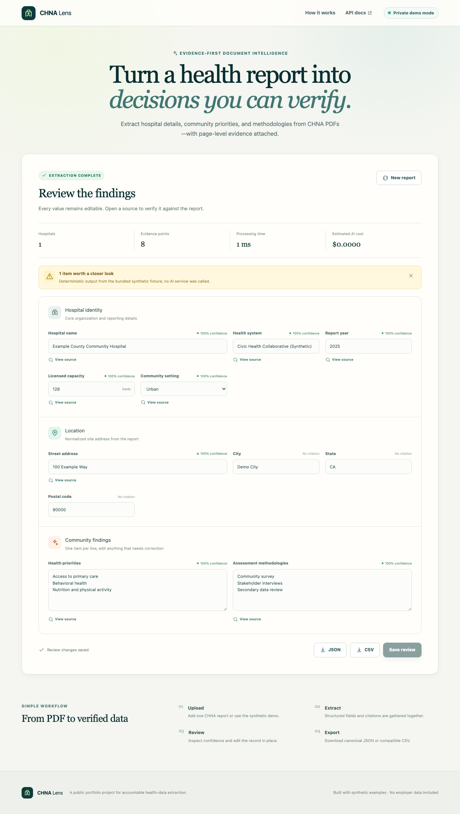

# CHNA Extractor

I built this project to turn Community Health Needs Assessment PDFs into structured hospital data
that can still be checked against the original report.

It is a clean public rewrite of work I explored during my internship at Metopio. It does not contain
Metopio code, data, credentials, branding, or internal configuration.



## What it does

- Extracts hospital details, locations, capacity, health priorities, and assessment methods.
- Keeps page numbers, excerpts, confidence, warnings, timing, token usage, and estimated cost.
- Supports one PDF or resumable batch processing with JSON and legacy-compatible CSV exports.
- Uses PyMuPDF for text extraction and can fall back to bounded Tesseract OCR.
- Includes a FastAPI API, CLI, SQLite job store, and React review interface.
- Runs without credentials using a bundled synthetic report.

## Run it locally

You need Python 3.13, Node.js 24, and [uv](https://docs.astral.sh/uv/).

```bash
make setup
make demo
make dev
```

Open `http://localhost:5173` and choose **Try sample report**. API docs are available at
`http://localhost:8000/docs`.

Useful CLI commands:

```bash
uv run chna demo --output demo-result.json
uv run chna estimate path/to/report.pdf
uv run chna extract path/to/report.pdf --mode live
uv run chna batch reports/ --recursive --output-dir chna-output
```

## Live extraction

Arbitrary PDFs require a newly issued OpenAI key:

```dotenv
CHNA_OPENAI_API_KEY=your_sandbox_key
```

The default model is `gpt-5.6-terra`. `chna estimate` shows expected and worst-case cost before a
request, and live runs are bounded by a US$10 default cap. Google Maps, web search, OCR, and source
retention are off by default.

## Checks

```bash
make check
make test-e2e
make security
docker compose build
```

The backend currently has 47 passing tests, one opt-in live test, and 90.93% coverage. Normal tests
do not contact external providers.

More detail: [architecture](docs/ARCHITECTURE.md), [API and CLI](docs/API_CLI.md),
[security](docs/SECURITY_AND_PRIVACY.md), and [validation](docs/VALIDATION_REPORT.md).

## Notes

- The included PDF and screenshots are synthetic.
- This is a review tool, so extracted evidence should still be checked against the report.
- Docker Compose binds to localhost; the API needs authentication before shared hosting.
- No license is granted for my original code. Dependencies keep their own terms, including
  PyMuPDF's AGPL-3.0/commercial terms. See [third-party notices](THIRD_PARTY_NOTICES.md).
