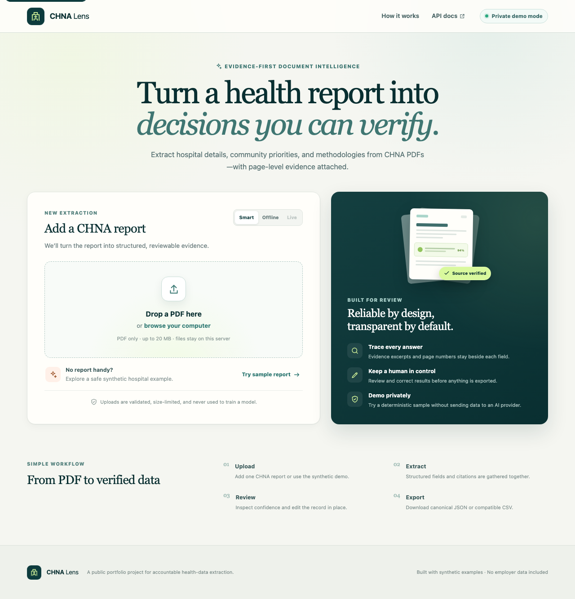

# CHNA Lens web app

The React interface for the CHNA Extractor. It supports safe PDF upload, deterministic offline demonstrations, extraction progress, evidence review, in-place corrections, and JSON/CSV export.




## Run locally

```bash
npm install
npm run dev
```

Vite proxies `/api`, `/healthz`, and `/readyz` to `http://127.0.0.1:8000`. Set `VITE_API_BASE_URL` only when the API is hosted elsewhere.

## Quality checks

```bash
npm run typecheck
npm run lint
npm test
npm run build
npm run test:e2e
```

The Playwright matrix covers mocked desktop/mobile journeys and a real local FastAPI journey through the bundled synthetic PDF, review save, and both exports. The backend virtual environment must exist at `../.venv`; no normal test calls OpenAI or a third-party service.
